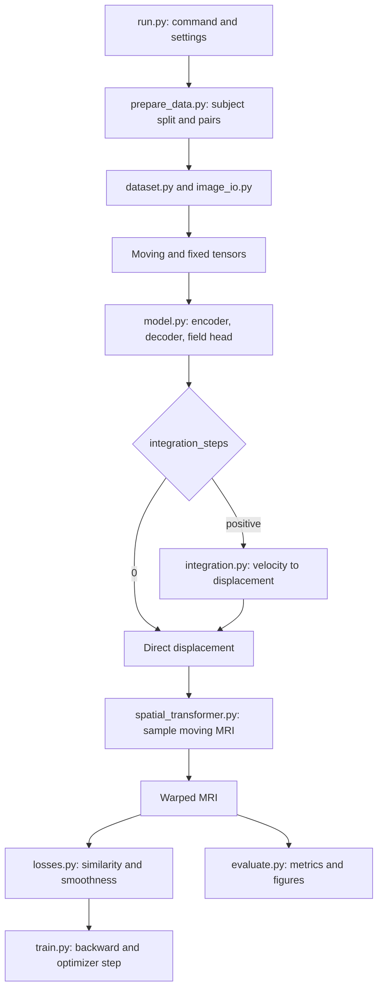

# How the registration project works

## The design decisions

We start with one task: deform one preprocessed 2D MRI to match another. The fixed image defines the target grid. The moving image supplies the intensities. The network changes sampling geometry rather than generating new MRI intensities. Training needs image pairs but not true deformation labels.

Separate responsibilities make this easier to understand and test. Loading knows file formats; the model knows features; the sampler knows coordinates; losses know differentiable objectives; training knows optimization; evaluation knows reporting. A single entry point joins these functions. Importing train.py no longer starts training.

The U-Net architecture keeps the original 16/32/32 encoder and 32/16 decoder widths. Resizing to exact skip-connection shapes fixes odd-sized images without changing learned parameter shapes. The final convolution is initialized close to zero, so the initial map is close to identity. Checkpoints record integration mode so the meaning of the field cannot silently change during inference.

Validation is separate from training and selects the checkpoint with the lowest combined validation objective. This choice is observable and reproducible, though it need not select the highest anatomical Dice. Segmentations are only used for reporting here. Test subjects do not enter training or checkpoint selection.

## The data path

Each arrow carries values through function arguments and return values. Variable names do not connect files automatically.

## Tensor and coordinate dictionary

- `moving`, `fixed`: float tensors [B,1,H,W]. B is batch size; 1 is grayscale channel.
- concatenated images: [B,2,H,W].
- encoder features: approximately half, quarter, eighth resolution.
- decoder features: [B,16,H,W].
- predicted field and final displacement: [B,2,H,W].
- `flow[:,0]`: horizontal x sampling offset; `flow[:,1]`: vertical y offset.
- `warped`: [B,1,H,W].
- `moving[0,0]`: whole 2D image from first batch item and channel, not pixel (0,0).
- plotted arrays: [H,W]; exported field `flow_xy`: [2,H,W].

At output location (y,x), the warped image samples moving at (y+uy,x+ux). Thus positive x sampling displacement makes visible content move left. This is a backward sampling map, not the destination of each moving pixel. PyTorch grid_sample expects normalized (x,y) coordinates; the sampler handles the conversion.

## File and function guide

### run.py

`main()` parses one command, validates settings, and dispatches. `prepare` only prepares data; `train` only trains; `evaluate` only reports a checkpoint; `register` handles one pair; `pipeline` prepares if needed, trains, then evaluates the best model. Imports are deferred until the selected action, so `--help` performs no data loading or training.

### config.py

Constants provide default epochs, learning rate, batch size, smoothness, seed and integration steps. There are no classes because this file has no behavior. CLI options override defaults. Saved settings describe the actual run, not merely current defaults.

### prepare_data.py

`prepare(data_dir, archive=None, seed=42)` verifies the archive checksum, reads normalized MRI and segmentations directly from the tar, creates subject-level splits, converts intensities to PNG, retains labels as integer NumPy sidecars, and records manifests. It returns the prepared folder. No archive paths are extracted to disk. When a local archive is supplied, no download is needed.

### image_io.py

`load_array(path, labels=False)` reads supported formats, rejects nonfinite/full-volume arrays, and normalizes intensity inputs if needed. Labels are validated as integers and are not intensity-normalized.

`load_image(path)` adds a grayscale channel and returns [1,H,W].

`save_registration(output_dir, moving, fixed, warped, flow, fixed_path=None)` saves exact NumPy arrays, a PNG preview and, for a NIfTI fixed image, a warped NIfTI in the fixed affine. The field units are still pixels.

### dataset.py

`RegistrationDataset.__init__` finds explicit filename matches across moving/fixed folders and rejects same-path pairing. `__len__` counts pairs. `__getitem__` loads one pair and checks spatial shape. `load_image` is a static alias of the I/O helper for compatibility with earlier learning code. Different batch examples must have consistent sizes; no automatic padding collator is supplied.

### model.py

`ConvBlock.forward` applies learned convolution and LeakyReLU. `Encoder.forward` computes f1, f2, f3 at decreasing resolutions. `Decoder.forward` upsamples f3 to f2, concatenates their channels, repeats with f1, and restores input resolution. Those concatenations are U-Net skip connections. `FlowHead.forward` produces two field components, not image intensities. `Voxelmorph.forward` validates paired inputs, concatenates them, runs the backbone/head and integration, and returns final displacement.

### spatial_transformer.py

`SpatialTransformer.forward` builds coordinates, adds x/y offsets, normalizes for grid_sample, and samples with border padding. Linear interpolation is differentiable and used for MRI/vector fields. Nearest interpolation is used for segmentation labels. The same convention is used in training, integration, metrics and exports.

### integration.py

`IntegrateVelocityField.forward` starts with velocity / 2**steps and repeatedly sets u = u + warp(u,u). This composes a small transformation with itself. Zero steps passes through direct displacement. Positive steps approximate integration over unit time. This module contains no learned weights; gradients still pass through it. Invertibility in continuous theory is not a guarantee of zero measured folds on a discrete grid.

### losses.py

`mse_loss` averages squared intensity disagreement. `smoothness_loss` sums the average squared first differences along row and column axes. Training regularizes final displacement, including when integration is enabled.

`NCCLoss.forward` computes local squared normalized cross-correlation using convolutional window sums. The window follows input device and dtype. The returned negative mean is minimized. Squared NCC and its contrast properties differ from raw MSE; weights should be tuned independently. This loss is not anatomical Dice.

### checkpoint.py

`choose_device` resolves auto/CPU/CUDA and reports unavailable CUDA clearly. `load_model` reads weights safely with weights_only=True, reconstructs integration settings, loads parameters and switches to eval mode. It also accepts older direct-displacement state_dict/helper checkpoints. The architecture is fixed by this implementation; arbitrary external model architectures are not auto-detected.

### train.py

`epoch_loss` performs one loader pass. An optimizer means training: gradients are tracked, backward computes derivatives and step updates weights. No optimizer means validation: weights stay fixed. It returns averaged combined loss, similarity and smoothness separately, weighted by actual batch size.

`train` seeds random generators, builds split loaders, constructs model/optimizer, optionally restores state, then alternates train and validation passes. It saves last.pt for continuation and best.pt when validation improves, plus history and a curve. The epoch count is the total target count when resuming. A different output folder is used for new experiments to protect earlier results.

### register.py

`predict_pair` takes channel-first unbatched image tensors, adds the batch axis, runs the model and sampler without gradients, and returns 2D warped image plus field arrays.

`save_pair_figures` shows intensities, field magnitude and the same deformation applied to a regular grid. Vector magnitude is sqrt(ux**2+uy**2).

`register` loads one pair and checkpoint, predicts, and writes arrays/figures. It needs neither ground-truth deformation nor segmentation.

### metrics.py

`image_mse` measures intensity disagreement. `dice_for_label` makes Boolean masks for one label and computes 2*intersection/(sizeA+sizeB). `dice_per_label` repeats that calculation over the union of foreground labels. `mean_dice` averages equally across labels. Missing-both labels are undefined, not invented perfect scores.

`jacobian_determinant` differentiates x/y displacement along array axes and evaluates det(I+grad(u)). `fold_fraction` counts nonpositive determinants. A constant translation has determinant 1; negative determinants indicate local orientation reversal.

### evaluate.py

`evaluate` reconstructs the checkpoint, processes every test pair, reports before/after MSE and folding, and exports selected examples. If segmentation sidecars exist, it samples moving labels with nearest interpolation and calculates label Dice. Labels never enter inference or the training loss. It writes a JSON report with settings and per-pair results; undefined values become null.

### visualize.py

`save_figure` creates folders and saves/closes plots. `plot_registration` uses equal intensity scales and shared before/after error scales. `plot_flow_magnitude` displays pixel displacement length. `plot_warped_grid` shows the sampled regular grid. `plot_training_history` compares epoch means. `plot_segmentations` uses consistent label colors across paired arrays. Figures have descriptive titles only, with no assistant branding or watermark.

### tests/test_core.py

Tests use known small inputs, not assertions that a short MRI experiment must achieve a particular score. They verify identity/translation, preserved segmentation IDs, integration and finite gradients, distinct-folder pairing, analytically known overlap/folding, optimizer updates versus validation stability, odd-shaped inputs/checkpoint reconstruction and NCC gradients. The historical empty test files can hold additional focused tests as the project grows.

## What to learn from the experiment

Inspect the input pair, then the warped result, then the field and grid, then metrics. Image similarity rewards matching intensities; Dice independently checks anatomy. A low image loss can coexist with local folding. Changing integration, similarity, or smoothness requires a controlled validation experiment, not merely choosing the most attractive picture.

Keep preprocessing and splits fixed while changing one setting. Checkpoints and manifests make those choices reviewable. The next larger extension would be true 3D convolutions/sampling and physical-space preprocessing, not simply removing a singleton dimension from full scans.
